  

 

  

##  About Me

<table align="center">
  <tr border="none">
    <td width="52%" align="left">

- 🔭 I’m currently working as a `Full-Stack` & `Frontend` Developer.
- 🌱 I’m currently building `Multi-Tenant Web Apps`, `Interactive UI`, and `Flutter Mobile` projects :D
- 💻 Focused on `JavaScript`, `TypeScript`, `React`, `Next.js`, `Node.js`, `Flutter`, & `Python`.
- 🌐 Interactive 3D Portfolio: **[Explore 3D Profile](https://rezafahmi17.github.io/Rezafahmi17/)** · **[MotionFolio Live](https://portofolio-reza-fahmi-alkhamdani.netlify.app/)**
- 📍 From Indonesia 🇮🇩.

    </td>
    <td width="48%" align="center">
      
    </td>
  </tr>
</table>

##  Languages and Tools

  
  
  
  
  
  
  
  
  
  
  
  
  
  
  

##  My Statistics

<table align="center" style="border-collapse: collapse;">
  <tr>
    <td width="50%" align="center">
      
        
      
    </td>
    <td width="50%" align="center">
      
    </td>
  </tr>
</table>

## 🚀 Featured Projects & Repositories

| Project | Description | Main Stack | Links |
|:--|:--|:--|:--|
| **[MotionFolio](https://github.com/Rezafahmi17/Portofolio)** | Modern animated personal portfolio with smooth scrolling & interactive UI | `React` `Vite` `GSAP` `Lenis` | [Live Demo](https://portofolio-reza-fahmi-alkhamdani.netlify.app/) · [Repo](https://github.com/Rezafahmi17/Portofolio) |
| **[Emosiku](https://github.com/Rezafahmi17/emosiku)** | Interactive emotion & mood tracking management web application | `JavaScript` `Web App` | [Live Demo](https://pengelolaan-emosiku.vercel.app/) · [Repo](https://github.com/Rezafahmi17/emosiku) |
| **[Pengelolaan Kontrakan](https://github.com/Rezafahmi17/pengelolaankontrakan)** | Boarding house & rental property management application | `Flutter` `Dart` | [Repo](https://github.com/Rezafahmi17/pengelolaankontrakan) |
| **[SIM ORMAWA](https://github.com/Rezafahmi17/pengelolaan-ormawa-hmj-dan-hima)** | Multi-tenant campus organization (HMJ & HIMA) management platform | `TypeScript` `Multi-Tenant` | [Live Demo](https://sim-ormawa-polinela.vercel.app/) · [Repo](https://github.com/Rezafahmi17/pengelolaan-ormawa-hmj-dan-hima) |
| **[TemuToko (Tokotrif)](https://github.com/Rezafahmi17/tokotrif)** | Multi-store campus COD marketplace & real-time transaction workflow | `Next.js` `Express` `MySQL` | [Live Demo](https://tokotrif-polinela.vercel.app/) · [Repo](https://github.com/Rezafahmi17/tokotrif) |
| **[JEKPOL Polinela](https://github.com/Rezafahmi17/jekpol-polinela)** | Campus transportation & ride-booking application for students and drivers | `Flutter` `Dart` `PHP` | [Repo](https://github.com/Rezafahmi17/jekpol-polinela) |
| **[KEUANGANKU](https://github.com/Rezafahmi17/KEUANGANKU)** | Personal finance & digital wallet tracking web application | `HTML` `CSS` `JavaScript` | [Live Demo](https://dompetkeuanganku.netlify.app/) · [Repo](https://github.com/Rezafahmi17/KEUANGANKU) |
| **[Universitas Nusantara](https://github.com/Rezafahmi17/UNIVERSITAS-NUSANTARA)** | Academic & campus information portal for Universitas Nusantara | `JavaScript` `HTML` `CSS` | [Live Demo](https://universitas-nusantara.netlify.app/) · [Repo](https://github.com/Rezafahmi17/UNIVERSITAS-NUSANTARA) |
| **[TokoHub (Manajemen Toko)](https://github.com/Rezafahmi17/Manajemen-Toko)** | Multi-tenant store management for product sales, rentals, and reporting | `Next.js` `Express` `PostgreSQL` | [Repo](https://github.com/Rezafahmi17/Manajemen-Toko) |
| **[Kopi Nusantara](https://github.com/Rezafahmi17/kopi-nusantara)** | QR-based cafe table ordering & admin dashboard ([BDL Branch](https://kopi-nusantara-bdl.netlify.app/)) | `React` `Node.js` `MySQL` | [Live Demo](https://kopi-nusantara-jawa.netlify.app/) · [Repo](https://github.com/Rezafahmi17/kopi-nusantara) |
| **[Cari Makan Web](https://github.com/Rezafahmi17/Cari-Makan-Web)** | Online food ordering, cart system, and transaction status management | `React` `Express` `MySQL` | [Repo](https://github.com/Rezafahmi17/Cari-Makan-Web) |
| **[SMA N 1 Rajabasa Permai Plus](https://github.com/Rezafahmi17/SMA-N-1-Rajabasa-Permai-Plus)** | Official school profile & academic portal website | `JavaScript` `Web` | [Live Demo](https://sma-n-1-rajabasa-permai-plus.netlify.app/) · [Repo](https://github.com/Rezafahmi17/SMA-N-1-Rajabasa-Permai-Plus) |
| **[EduMeta AI Chatbot](https://github.com/Rezafahmi17/chatbot)** | AI learning assistant powered by Gemini ([Streamlit Demo](https://github.com/Rezafahmi17/-chatbot-streamlit-demo)) | `Python` `Streamlit` `Gemini` | [Repo](https://github.com/Rezafahmi17/chatbot) |
| **[Pengelolaan UKM, HMJ & HIMA](https://github.com/Rezafahmi17/Pengelolahan-UKM-HMJ-dan-HIMA)** | Web administration system for student activity units & organizations | `PHP` `MySQL` | [Repo](https://github.com/Rezafahmi17/Pengelolahan-UKM-HMJ-dan-HIMA) |
| **[Keamanan Web Kantin](https://github.com/Rezafahmi17/versi-Aman-kantin)** | Web application security lab: [Secure Version](https://github.com/Rezafahmi17/versi-Aman-kantin) & [Vulnerable Version](https://github.com/Rezafahmi17/-versi-rentan-kantin) | `HTML` `Web Security` | [Repo](https://github.com/Rezafahmi17/versi-Aman-kantin) |

 

##  My Contributions & Live Activity

  

  <picture>
    <source media="(prefers-color-scheme: dark)" srcset="./assets/github-contribution-grid-snake-dark.svg" />
    <source media="(prefers-color-scheme: light)" srcset="./assets/github-contribution-grid-snake.svg" />
    
  </picture>

  

  
   
  🐍 Live Contribution Snake &amp; Pac-Man Grid · <a href="https://rezafahmi17.github.io/Rezafahmi17/"><b>Interactive 3D Version</b></a> · <a href="https://github.com/Rezafahmi17?tab=repositories"><b>View All 19 Repositories</b></a>

