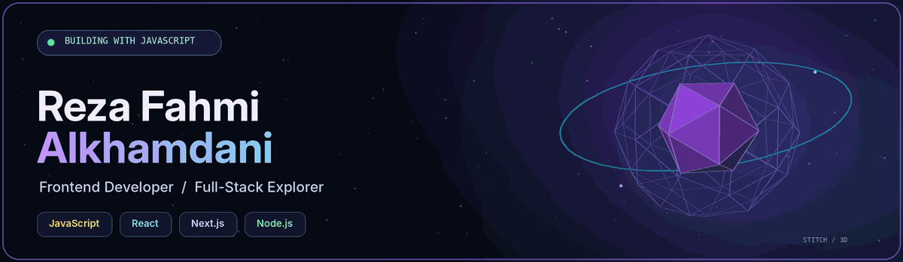

  

  
<strong>Building practical digital products, one commit at a time.</strong>

  

    
    
    
  

  
<code>JavaScript First</code> &nbsp; · &nbsp; <code>3D Interactive Web</code> &nbsp; · &nbsp; <code>Always Learning</code>

## About Me

Halo! Saya **Reza Fahmi Alkhamdani** (`@Rezafahmi17`). Saya fokus membangun aplikasi web yang responsif, rapi, dan nyaman digunakan. Fokus utama saya adalah **JavaScript**, mulai dari pengembangan frontend hingga aplikasi full-stack.

- ⚡ **Saat ini:** Mengeksplorasi React, Next.js, API, dan sistem **multi-tenant**.
- 🎨 **Yang saya suka:** Antarmuka modern, animasi, micro-interactions, dan desain yang fungsional.
- 🛠️ **Jenis proyek:** Sistem pemesanan, marketplace, dashboard manajemen, aplikasi kampus, serta eksperimen AI.
- 🌱 **Prinsip belajar:** Build, test, improve, repeat.

## Tech Stack

  
<strong>Languages & Frontend</strong>

  
  
<strong>Backend & Data</strong>

  
  
<strong>Tools & Platforms</strong>

  

## Featured Projects

<!-- Semua proyek berikut diarahkan ke repository publik yang diverifikasi pada akun Rezafahmi17. -->

| Project | Highlight | Stack |
|:---|:---|:---|
| **[MotionFolio](https://github.com/Rezafahmi17/Portofolio)** | Interactive portfolio with GSAP animations and Lenis smooth scroll | `React` `Vite` `GSAP` |
| **[Kopi Nusantara](https://github.com/Rezafahmi17/kopi-nusantara)** | QR-code table ordering and cafe administration | `React` `Node.js` `MySQL` |
| **[Cari Makan Web](https://github.com/Rezafahmi17/Cari-Makan-Web)** | Food ordering, cart, transaction dashboard and order statuses | `React` `Express` `MySQL` |
| **[TokoHub](https://github.com/Rezafahmi17/Manajemen-Toko)** | Multi-tenant shop management, product sales and rentals | `Next.js` `Express` `PostgreSQL` |
| **[SIM ORMAWA](https://github.com/Rezafahmi17/pengelolaan-ormawa-hmj-dan-hima)** | Management system for campus organizations, HMJ and HIMA | `Multi-Tenant` `Web` |
| **[TemuToko](https://github.com/Rezafahmi17/tokotrif)** | Multi-store marketplace prototype using COD transactions | `Next.js` `Socket.IO` `MySQL` |
| **[JEKPOL](https://github.com/Rezafahmi17/jekpol-polinela)** | Campus ride-ordering mobile application | `Flutter` `Dart` `PHP` |
| **[EduMeta AI](https://github.com/Rezafahmi17/chatbot)** | AI study assistant with Streamlit and Gemini | `Python` `Streamlit` `Gemini` |

  <a href="https://github.com/Rezafahmi17?tab=repositories"><strong>Explore all public repositories →</strong></a>

## More Work

- **[KEUANGANKU](https://github.com/Rezafahmi17/KEUANGANKU)** — aplikasi keuangan pribadi dengan visualisasi data dan antarmuka glassmorphism.
- **[SMA N 1 Rajabasa Permai Plus](https://github.com/Rezafahmi17/SMA-N-1-Rajabasa-Permai-Plus)** — website sekolah dengan halaman publik dan panel admin.
- **[Pengelolahan UKM, HMJ, dan HIMA](https://github.com/Rezafahmi17/Pengelolahan-UKM-HMJ-dan-HIMA)** — implementasi manajemen organisasi berbasis multi-tenant menggunakan PHP dan MySQL.

## GitHub Activity

  <!-- Statistik berasal dari layanan pihak ketiga; jika layanan sedang tidak aktif, gambar bisa sementara tidak tampil. -->
  
   
  Statistik dapat berubah mengikuti aktivitas repository publik dan ketersediaan penyedia widget.

## Let's Connect

Tertarik berdiskusi tentang **JavaScript**, desain antarmuka, aplikasi web, atau pengembangan produk digital?

  <a href="https://github.com/Rezafahmi17">GitHub Profile</a>
  &nbsp;·&nbsp;
  <a href="https://github.com/Rezafahmi17/Portofolio">Portfolio Source</a>
  &nbsp;·&nbsp;
  <a href="https://github.com/Rezafahmi17?tab=repositories">All Repositories</a>

Based on the uploaded Stitch Three.js scene · GitHub README displays an animated GIF · Full 3D is on GitHub Pages

