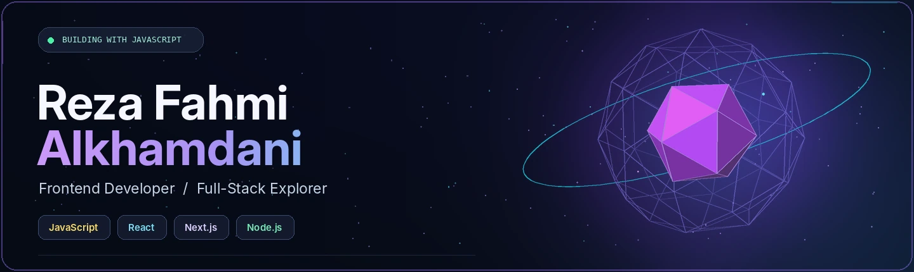

 

**Building polished digital products with JavaScript.**

<a href="https://rezafahmi17.github.io/Rezafahmi17/"><b>Explore Interactive 3D Website</b></a> · <a href="https://github.com/Rezafahmi17?tab=repositories"><b>All Projects</b></a> · <a href="https://github.com/Rezafahmi17/Portofolio"><b>MotionFolio</b></a>

JavaScript &nbsp; / &nbsp; React &nbsp; / &nbsp; Next.js &nbsp; / &nbsp; Node.js &nbsp; / &nbsp; Multi-Tenant Systems

---

### About Me

Halo! Saya **Reza Fahmi Alkhamdani**, seorang developer yang fokus pada **JavaScript**, tampilan web interaktif, dan pengembangan aplikasi full-stack. Saya senang mengubah ide menjadi produk digital yang responsif dan mudah digunakan — dari dashboard manajemen hingga platform multi-tenant.

### Tools & Technologies

**Frontend**

**Backend & Data**

**Developer Tools**

### Featured Projects

| Project | What it does | Main Stack |
|:--|:--|:--|
| **[MotionFolio](https://github.com/Rezafahmi17/Portofolio)** | Modern animated portfolio with smooth scrolling | `React` `Vite` `GSAP` `Lenis` |
| **[Kopi Nusantara](https://github.com/Rezafahmi17/kopi-nusantara)** | QR-based cafe ordering and admin dashboard | `React` `Node.js` `MySQL` |
| **[Cari Makan Web](https://github.com/Rezafahmi17/Cari-Makan-Web)** | Online food orders, cart, and transaction management | `React` `Express` `MySQL` |
| **[TokoHub](https://github.com/Rezafahmi17/Manajemen-Toko)** | Multi-tenant stores, sales, and rentals | `Next.js` `Express` `PostgreSQL` |
| **[SIM ORMAWA](https://github.com/Rezafahmi17/pengelolaan-ormawa-hmj-dan-hima)** | Multi-tenant campus organization management | `Web` `Multi-Tenant` |
| **[TemuToko](https://github.com/Rezafahmi17/tokotrif)** | Multi-store COD marketplace prototype | `Next.js` `Express` `MySQL` |
| **[JEKPOL](https://github.com/Rezafahmi17/jekpol-polinela)** | Campus transportation booking application | `Flutter` `Dart` `PHP` |
| **[EduMeta AI](https://github.com/Rezafahmi17/chatbot)** | Learning assistant using Gemini | `Python` `Streamlit` |

**More work:** [KEUANGANKU](https://github.com/Rezafahmi17/KEUANGANKU) · [School Website](https://github.com/Rezafahmi17/SMA-N-1-Rajabasa-Permai-Plus) · [Other Repositories](https://github.com/Rezafahmi17?tab=repositories)

### Connect

Open to collaborations, creative frontend development, and full-stack projects.

[GitHub](https://github.com/Rezafahmi17) · [Interactive 3D Profile](https://rezafahmi17.github.io/Rezafahmi17/) · [Portfolio Repository](https://github.com/Rezafahmi17/Portofolio)

---

Animated image: native 1440 × 430, 60 fps looping WebP. Full mouse-interactive Three.js version available via GitHub Pages. If the animation is restricted in your browser, switch to the included GIF alternative (`assets/banner-premium-30fps.gif`).
